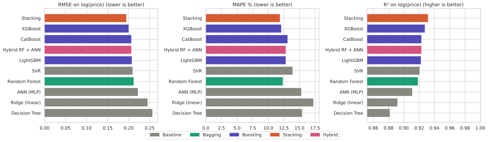

# Ensemble Learning Dashboard: Sri Lankan Used-Car Prices

Hands-On Ensemble Learning Project - Machine Learning and Pattern Recognition
**Student:** Vineth Nallaperuma

**Live dashboard:** [_sl-vehicle-ensemble-224131f.streamlit.app_](https://sl-vehicle-ensemble-224131f.streamlit.app/)

This project predicts the asking price of used cars in Sri Lanka and compares the three ensemble paradigms (**bagging, boosting, stacking**) and a **hybrid Random Forest + ANN** model, with an interactive Streamlit dashboard for model comparison, feature importance and live predictions.



## Dataset
**SriLankan Vehicle (Car) Price Dataset** by Prasad Nirmal ([Kaggle](https://www.kaggle.com/datasets/prasadnirmal/srilankan-second-vehiclecar-price-dataset), version 3, MIT licence): 9,788 car listings scraped from the Sri Lankan marketplaces **ikman.lk** and **Riyasewana.com** between December 2024 and February 2025. After cleaning: 9,769 listings (18 duplicates and one clearly erroneous row removed).

Two findings shaped the modelling:
- **Mileage in this dataset is synthetic.** Every car's mileage is exactly age × 11,000 km, so it adds no information beyond age and was dropped.
- **Sri Lanka's vehicle import ban (March 2020 - 1 Feb 2025)** means only 58 cars made in 2020 or later are in the data, so all models are least reliable for the newest cars. A "listed after the ban was lifted" feature was added (it turned out to have no effect on asking prices in this short window).

## Results (held-out test set, 1,954 cars)

| Model | Family | RMSE (log) | R² (log) | MAPE | MAE (lakhs) |
|---|---|---|---|---|---|
| **Stacking** (RF + LightGBM + CatBoost + SVR → Ridge) | Stacking | **0.195** | **0.932** | **11.9%** | **5.28** |
| XGBoost | Boosting | 0.201 | 0.928 | 12.1% | 5.46 |
| CatBoost | Boosting | 0.207 | 0.923 | 13.1% | 5.86 |
| Hybrid RF + ANN | Hybrid | 0.207 | 0.923 | 12.8% | 5.60 |
| LightGBM | Boosting | 0.208 | 0.923 | 12.8% | 5.71 |
| SVR | single model | 0.210 | 0.921 | 13.9% | 6.68 |
| Random Forest | Bagging | 0.213 | 0.919 | 12.4% | 5.43 |
| ANN (MLP) | single model | 0.222 | 0.911 | 15.3% | 7.49 |
| Ridge regression | single model | 0.245 | 0.892 | 17.3% | 8.83 |
| Decision Tree | single model | 0.257 | 0.882 | 15.4% | 7.18 |

The best model prices **68% of unseen cars within ±10%** and **85% within ±20%** of their asking price. The full interpretation (why each model behaved as it did on Sri Lankan data, strengths and limitations, and a reflection on tabular vs image/text data) is in Sections 10-11 of the notebook.

## Method
- Target: `log(price)` (raw prices are heavily right-skewed); predictions converted back with `exp()`.
- Preprocessing inside scikit-learn `Pipeline`s, fitted on training data only: target encoding for car model (1,555 distinct values), one-hot encoding for other categories, scaling for SVR / ANN / Ridge. CatBoost uses its native categorical handling.
- Tuning: `GridSearchCV`, 3-fold CV, scored by RMSE on log(price).
- Evaluation: 80/20 train/test split; RMSE on log(price) as the primary metric (close to a relative error, fair to cheap and expensive cars), plus MAE, R² and MAPE.
- Hybrid: residual RF + ANN. The ANN learns to correct the Random Forest's out-of-fold errors.

## Repository structure
```
ensemble_vehicle_prices.ipynb   # full analysis notebook (executed, with outputs)
ml_utils.py                     # shared cleaning, features, pipelines, hybrid + CatBoost wrapper
app.py                          # Streamlit dashboard
data/vehicle_prices.csv         # dataset (unchanged Kaggle file)
models/*.pkl                    # trained models (joblib)
results/                        # metrics, permutation importance, test predictions, metadata
figures/                        # charts exported by the notebook
requirements.txt
```

## Run locally
```bash
pip install -r requirements.txt
streamlit run app.py                         # dashboard
jupyter notebook ensemble_vehicle_prices.ipynb   # re-run the analysis (about 10 minutes)
```
The `.pkl` files were saved with the exact library versions in `requirements.txt` (Python 3.13); use the same versions to load them.


## References
- Breiman (2001), Random Forests; Friedman (2001), Gradient Boosting; Wolpert (1992), Stacked Generalization
- Chen & Guestrin (2016), XGBoost; Ke et al. (2017), LightGBM; Prokhorenkova et al. (2018), CatBoost
- Grinsztajn, Oyallon & Varoquaux (2022), Why do tree-based models still outperform deep learning on typical tabular data?
- Shwartz-Ziv & Armon (2022), Tabular data: Deep learning is not all you need
